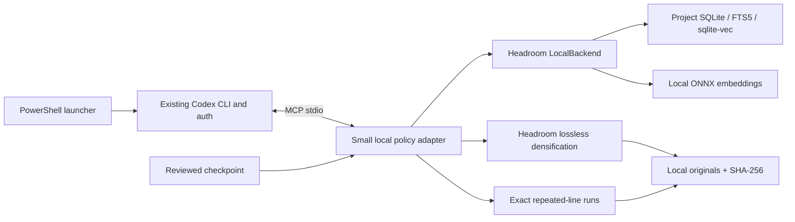

# Architecture

No HTTP listener, model proxy, additional LLM, cloud memory or API credential is introduced.
The launcher supplies one MCP server through supported per-process `codex -c` overrides;
global provider, auth, model and approval configuration remain unchanged. Other global MCPs
remain the user's choice. Launch through `cdm.ps1 start` to activate this integration.

Each project has a real independent Headroom database. `user_id=project` is safe because databases
are separate. Headroom owns SQLite, FTS5, vector indexes and embedding execution. A small JSON
index maps stable keys to active native record IDs, caches read hashes and keeps the last 1000
payload metrics. A filesystem lock serializes operations from hooks, CLI and MCP. It is intended
for a single user's local project, not a distributed database or concurrent network filesystem.

Writes are assisted: the agent submits atomic facts or updates a short checkpoint. Same key/content
is a no-op; equal facts share IDs. Replacing a key retires an unreferenced prior record. A crash between
native storage and index publication can leave an unreachable native row; active retrieval filters
against the index. This is not a cross-database ACID transaction. Back up the directory while processes
are stopped before migration. The first release does not migrate third-party memory schemas.

`Stop` and `PreCompact` use official Codex hooks to ingest only `.codex-dev-memory/checkpoint.md`.
They do not read transcripts, summarize autonomously, force continuation, intercept user prompts
or bypass hook trust. A manually tested hook payload does not prove the user has trusted a hook.
`checkpoint` is the reliable explicit alternative. `SessionEnd` was omitted due to its short timeout.

Native lossless mode is conservative: a transformation that fails its reversibility checks reverts
to the original. For repetitive plain logs this produced no savings, so the adapter adds exact
run-length encoding of consecutive equal lines. The header explains decoding; order, counts and
errors are preserved. Source code is never compressed. SHA-256 artifacts recover original UTF-8
text across process restarts; non-UTF-8 files must be converted explicitly by the user.

Português: o Codex acessa a memória via MCP local. O Headroom é o único motor de armazenamento
e busca. O adaptador acrescenta validação, ciclo de vida, deduplicação por chave, recuperação de
originais e métricas; não intercepta a autenticação nem modifica solicitações do usuário.
